<picture>
  <source media="(prefers-color-scheme: dark)" srcset="images/banner-dark.svg">
  
</picture>

  

  
  
  
  

 

<table>
  <tr>
    <td width="62%" valign="top">
      <h3>About</h3>
      
I build <b>the backend that moves a million orders a day</b>.

      
10+ years in software, the last 7 on backend and distributed platforms: high-throughput systems that stay reliable under production pressure.

      
At <a href="https://www.linkedin.com/company/theporter-in/">Porter</a> I own the <b>order-lifecycle domain</b>, and spend my time on domain design, database performance, and org-wide tooling, including LLM-powered observability and AI-assisted engineering.

    </td>
    <td width="38%" valign="top">
      <h3>At a glance</h3>
      
📦 <b>1M+</b> orders a day

      
⚡ <b>2,000+</b> requests per second

      
🧭 <b>10+</b> years engineering

      
📍 Bengaluru, India

    </td>
  </tr>
</table>

## Now at Porter

<table>
  <tr>
    <td width="50%" valign="top">
      <h4>🏗️ Order-lifecycle re-architecture</h4>
      Clear subdomains and high-throughput pipelines, so teams ship new order flows without stepping on each other.
    </td>
    <td width="50%" valign="top">
      <h4>🗄️ Automated PostgreSQL partitioning</h4>
      Our largest tables partition themselves, cutting slow queries and database CPU cost.
    </td>
  </tr>
  <tr>
    <td width="50%" valign="top">
      <h4>🤖 An LLM agent that watches the database</h4>
      Real-time load monitoring with automatically written incident reports, so we notice problems sooner.
    </td>
    <td width="50%" valign="top">
      <h4>📸 Proof of Delivery</h4>
      Designed end to end across the driver, customer, and operations systems.
    </td>
  </tr>
</table>

## Toolkit

  

  
  
  
  
  

Domain-Driven Design &nbsp;/&nbsp; Event-driven &nbsp;/&nbsp; Hexagonal &nbsp;/&nbsp; Microservices

## Where I've worked

| | Role | Company | Period |
|:-:|---|---|---|
| 🟡 | **Senior Software Engineer (SDE-3)** | **Porter** | Oct 2022 – present |
| ⚪ | Senior Developer | Publicis Sapient | Mar 2021 – Oct 2022 |
| ⚪ | Senior Developer | Coolwinks Technologies | Oct 2019 – Mar 2021 |
| ⚪ | Lead Engineer | HCL Technologies | Oct 2017 – Sep 2019 |
| ⚪ | Software Engineer | Appzlogic Mobility Solutions | Mar 2016 – Oct 2017 |

Highlights from earlier roles

 

- **Publicis Sapient.** Led a team shipping AI-driven customer-insight features for US Bank's retail app (3M+ daily users); owned API contracts and design reviews for service integrations.
- **Coolwinks.** Built runtime algorithm selection for cart-abandonment analytics, integrated payment gateways, and led mobile verticals serving 4M+ users.
- **HCL Technologies.** Real-time event tracking over persistent sockets, protocols between mobile apps and embedded WiFi devices, and a 50% cut in device boot time.
- **Appzlogic.** Built apps from scratch for healthcare, warehouse logistics, and accessibility, including hands-free warehouse scanning with real-time sync.

## How I work

<table>
  <tr>
    <td align="center" width="25%"><b>Simple by default</b> Complexity has to earn its place in production.</td>
    <td align="center" width="25%"><b>Measure first</b> Optimise where the numbers say it matters.</td>
    <td align="center" width="25%"><b>Automate toil</b> Let machines, and agents, do the repetitive work.</td>
    <td align="center" width="25%"><b>Boring in production</b> Predictable beats clever.</td>
  </tr>
</table>

## Contribution activity

  

Fast systems. Clear ownership. Fewer production surprises.

